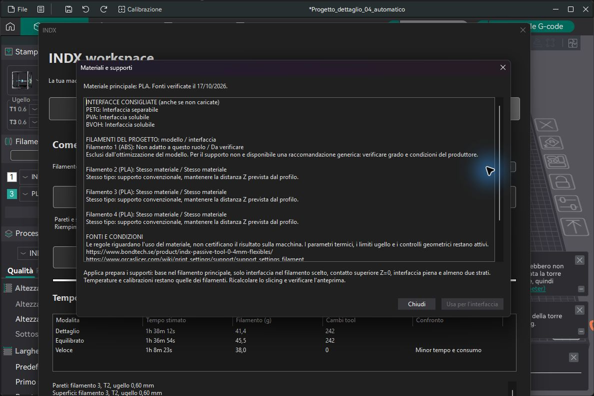

# Materiali per modello e interfaccia

Fonti ufficiali consultate il **17 ottobre 2026**. La matrice e uno snapshot versionato incluso nel programma, disponibile offline; non scarica regole eseguibili da internet durante lo slicing. Una coppia valida su un esempio non certifica ogni marca, durezza o blend.

| Modello | Altro materiale | Nel modello / infill | Come interfaccia |
|---|---|---|---|
| PLA | PETG | Escluso | Separabile, anche al contrario |
| PETG | TPU | Condizionale: adesione e flessibilita da provare | Non suggerito per distacco |
| PLA | TPU | Condizionale: dipende dalla formulazione | Non suggerito per distacco |
| PLA | PVA / BVOH | Escluso come infill alternativo | Solubile, grado adatto e asciutto |
| PETG | BVOH | Escluso come infill alternativo | Solubile |
| PETG | PVA generico | Non documentato | Non suggerito; preferire BVOH |
| ABS / ASA | HIPS | Non documentato | Condizionale; verificare prodotto e solvente |
| PA11-CF | PETG | Non documentato | Esempio specifico, non esteso ad altri nylon |
| CF/GF, blend o tipi non elencati | Altro tipo | Nessuna deduzione automatica | Da verificare |

## In Orca

Aprire **INDX > Auto slicing optimization > Materiali e supporti**. La pagina mostra il ruolo di ogni filamento del progetto, condizioni e fonti; elenca anche i tipi consigliati non caricati. Il pulsante **Usa per l’interfaccia** e disponibile solo per una coppia separabile/solubile consigliata gia presente. Il riepilogo dichiara le modifiche prima della scelta: supporti abilitati, base nel principale, interfaccia nel candidato, contatto superiore Z=0, spaziatura zero, almeno due strati superiori. Non cambia i profili filamento globali, temperature o calibrazioni. Protegge gli override locali; salva un processo nel progetto. Va ricalcolato e controllato il risultato in anteprima.

Le alternative rigido/flessibile nell’infill vengono solo misurate: richiedono risparmio e una scelta unica finale che evidenzia la variazione meccanica. Pareti e superfici mantengono il principale. Per TPU morbido consultare il tool Bondtech Standard 0,4 mm: una compatibilita fra polimeri non attesta l’idoneita di ogni ugello.

La validazione nativa controlla gli slot effettivamente usati e il loro ruolo. Il normale PLA o PETG puo fare da interfaccia senza essere marcato globalmente come supporto. Un filamento dedicato ai supporti assegnato a pareti o infill non aggira la verifica. I tool caricati ma inutilizzati non limitano il modello. Le interfacce consigliate evitano il falso blocco strutturale; coppie ignote o condizionali nei supporti conservano un avviso specifico. I controlli termici, geometrici e del piano condiviso restano attivi.

## Fonti e limiti

- [Prusa: combinazioni di materiali](https://help.prusa3d.com/article/combining-materials-xl_498103): PLA/PETG per supporti reciproci, gestione di piano e torre.
- [Prusa Pro: multimateriale](https://pro.prusa3d.com/guides/multi-material-printing/): esempi rigido/flessibile e PA11-CF/PETG; adesione da verificare.
- [Prusa: PVA e BVOH](https://help.prusa3d.com/article/water-soluble-materials-pva-bvoh_162860): differenza direzionale fra PLA e PETG.
- [Prusa: HIPS](https://help.prusa3d.com/article/hips_167118): il limonene puo attaccare ABS/ASA. Questa indicazione limita la raccomandazione generale nell’articolo sui solubili: nessuna scelta automatica HIPS/ABS/ASA.
- [Bondtech: tool per flessibili](https://www.bondtech.se/product/indx-passive-tool-0-4mm-flexibles/): geometria Standard dedicata ai materiali morbidi.
- [Orca: base e interfaccia](https://www.orcaslicer.com/wiki/print_settings/support/support_settings_filament): i due ruoli sono distinti.

Le indicazioni provenienti da altre stampanti sono usate come guida ai materiali. Il loro trasferimento alla SV08 Max INDX richiede il collaudo fisico; non ne vengono copiate macro o movimenti.

