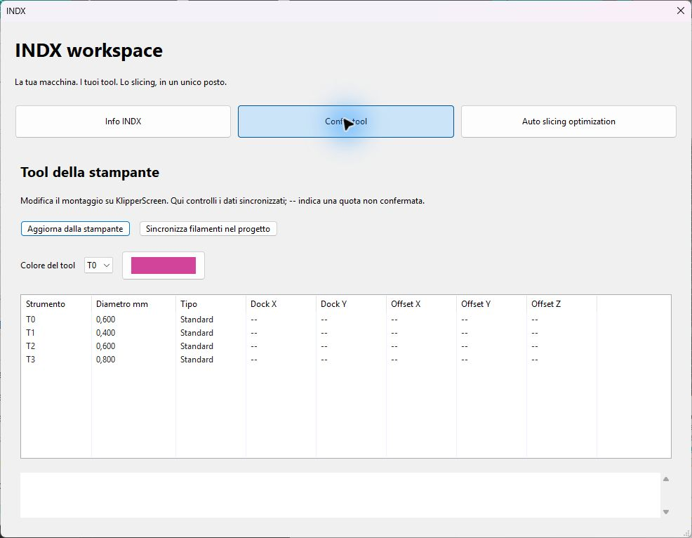
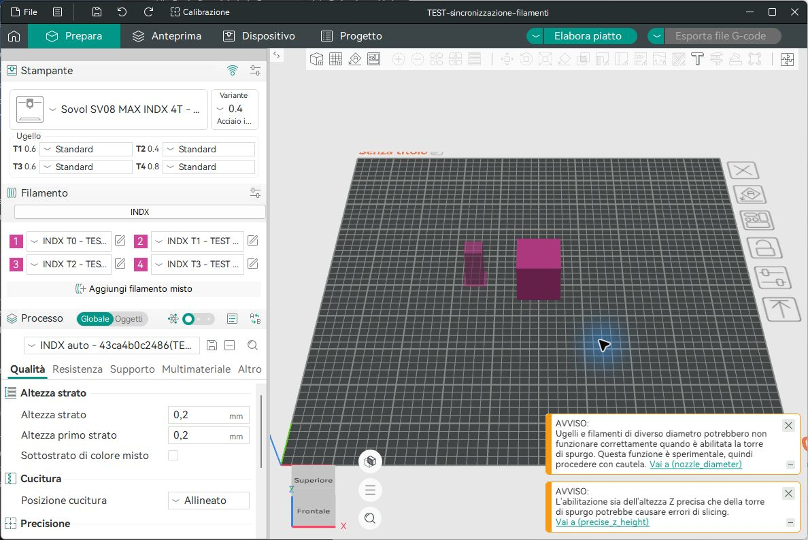

# Colori automatici e profili standard o personalizzati

## Sul touch

1. Aprire **INDX → Filamenti**, scegliere il tool, la libreria di basi, marca, materiale e profilo. Temperatura ugello, piano, flow e portata vengono dalla base Orca scelta, non da una tabella universale per il solo nome PLA/PETG.
2. Toccare il campione per scegliere il colore. La selezione su un profilo già assegnato salva subito solo il colore; non salva altri campi eventualmente modificati. Su una nuova base il colore rimane in bozza fino all'assegnazione.
3. **Usa valori standard:** salva e assegna una copia senza test, usando i valori originali della base e il colore scelto. Eventuali modifiche manuali nei campi non vengono trattate come valori stock. Nessuna calibrazione viene inventata.
4. **Salva personalizzato:** conserva le modifiche, chiede il nome e assegna il profilo. Si possono quindi eseguire PA, flow e portata e salvare i risultati. Partendo da uno standard viene creata un'identità separata, conservando lo standard per il riutilizzo.

Se si avvia una calibrazione da uno standard, al salvataggio del risultato viene creata una copia personalizzata. I risultati rimangono specifici per filamento, tool, diametro e tipo di ugello. La sola scelta standard non rende verificati PA, flow o portata.

## In Orca

**INDX → Config tool → Colore del tool** mostra un campione senza codice o nome del colore: selezionare Tn e toccare il campione per aprire la palette nativa. Il colore del progetto e il profilo scelto per il tool si sincronizzano automaticamente anche verso KlipperScreen. Una base Orca crea una copia standard senza test; un profilo INDX richiama il filamento personale e le calibrazioni applicabili.

Con Orca aperto e collegato, i profili assegnati dalla stampante aggiornano automaticamente i relativi slot del progetto: colore, temperature, valori di base e risultati di calibrazione ancora validi. La lettura avviene normalmente ogni 15 secondi, oltre ai tempi di rete. Slicing/esportazione, profili non salvati e finestre modali rimandano l'applicazione. Le copie generate modificate localmente richiedono confronto con **Sincronizza filamenti nel progetto**, invece di essere sovrascritte.

Le assegnazioni dei tool occupano i primi slot corrispondenti; eventuali slot aggiuntivi non assegnati dalla stampante vengono conservati. Il progetto aggiornato richiede un nuovo slicing prima della stampa: un G-code già esportato non viene modificato o inviato automaticamente. Le selezioni fatte in Orca vengono inviate con lo stato precedente atteso. Modifiche contemporanee al medesimo tool vengono segnalate senza sovrascriverle: usare il confronto esplicito per risolvere. Le risposte vecchie non sostituiscono una selezione effettuata mentre la rete lavorava.

## Verifiche

- GTK reale isolato: scelta/annullamento colore, aggiornamento immediato del record assegnato senza salvare temperature ancora in bozza, stock ripreso dalla base, copia personalizzata separata e identità stabile.
- Layout con pulsanti KlippyGtk reali, font 32 px, barre titolo/laterali, 4 e 12 tool a 1024×600 e 1280×800.
- Orca Windows Release con server Moonraker su loopback, senza connessione alla stampante: quattro assegnazioni applicate automaticamente; modifica simulata a colore e temperatura ricevuta senza premere Sincronizza. Il 3MF salvato contiene il nuovo colore in tutti i quattro slot e temperatura 220 °C.
- 356 asserzioni in 15 test IndxChecks e 1177 asserzioni in 6 test FFF INDX superati. Nessun movimento, riscaldamento o flash.
- Il controllo clang-tidy locale non è stato eseguito: lo script di progetto non riconosce il runtime Python portatile come installazione Python di sistema. La compilazione Release e i test sopra sono verificati separatamente.

I dati delle immagini e del test a 220 °C sono simulati e non prescrivono una temperatura per il filamento reale. I valori stock dipendono dalla base effettivamente scelta e restano da verificare sulla propria macchina.

La sincronizzazione verso il touch usa il servizio Linux `indx-filament-sync`, installabile con `install_klipperscreen.py --sync-service --restart` insieme ai percorsi della propria installazione. Esegue soltanto aggiornamenti di metadati e aspetta durante stampa o pausa. Il normale ciclo Orca dura 15-30 secondi oltre ai tempi di rete; il touch rileva il salvataggio entro circa un secondo. Alla prima connessione viene stabilita la base dalla stampante. Profili non salvati, finestre modali e slicing rimandano Orca. I tool con slot virtuali contraddittori non vengono esportati. Un colore diverso su un profilo condiviso crea una copia per non ricolorare gli altri tool.

La panoramica mostra PA, flow e portata anche senza test: **standard / stimato** è distinto da **calibrato**. Catalogo e file sono memorizzati in cache con invalidazione su sostituzione esterna. Le pagine rimangono aperte e le bozze non vengono ricaricate cambiando schermata. Prova sullo SPI-XI, catalogo di 2.022 profili e 64 passaggi fra otto pagine: mediana **147,63 → 47,17 ms**, p95 **576,29 → 206,37 ms**. Si tratta di una misura di questa macchina, non di un limite garantito.

Test aggiunti: sincronizzazione inversa, richieste ripetute, conflitti, rifiuto atomico di un lotto, attesa durante stampa, ripresa dopo interruzione del salvataggio, colori indipendenti per tool che condividevano il profilo, aggiornamento delle cache esterne, protezione della bozza sul touch. Nessun movimento o riscaldamento durante i test.

Le copie generate vengono confrontate dopo la stessa normalizzazione eseguita da Orca nel salvataggio. La migrazione dei vecchi controlli ricostruisce esclusivamente la precedente ereditarietà: non ignora altre modifiche locali. Le impronte sono registrate dal profilo realmente salvato, evitando falsi conflitti a ogni aggiornamento.
