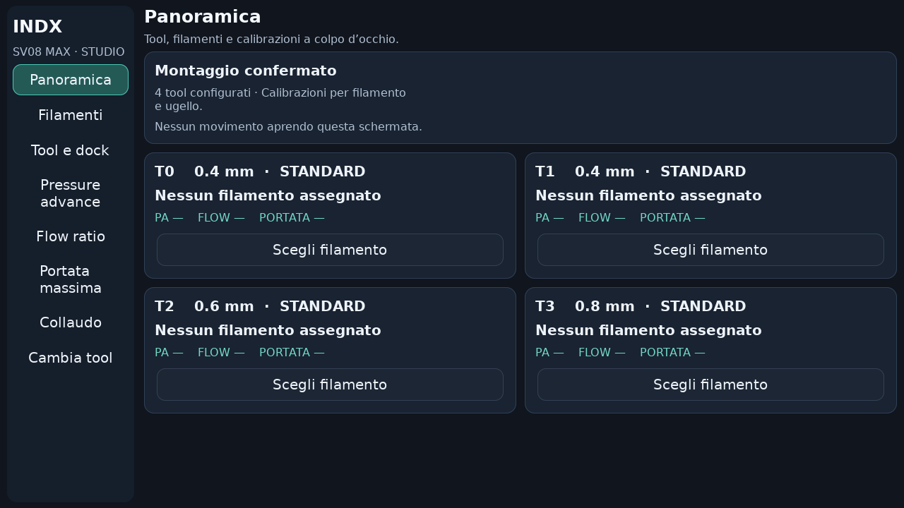
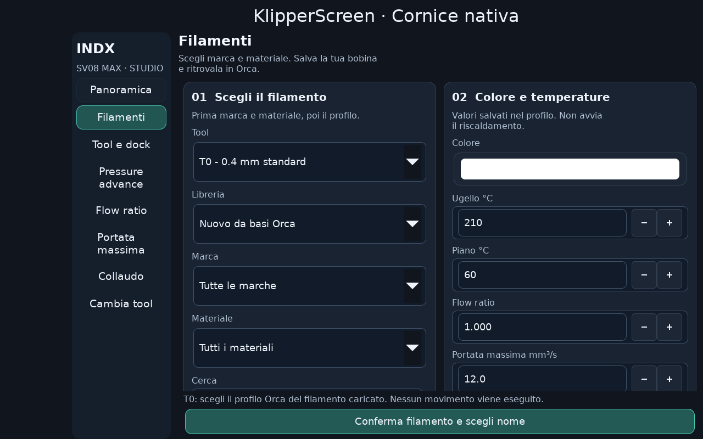
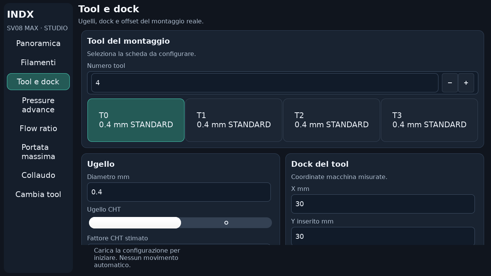
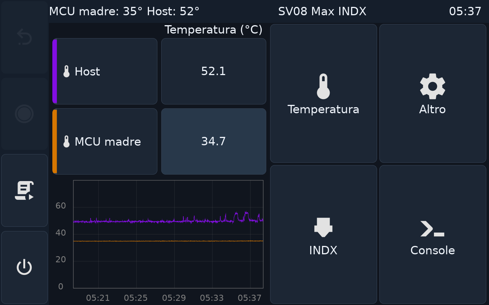
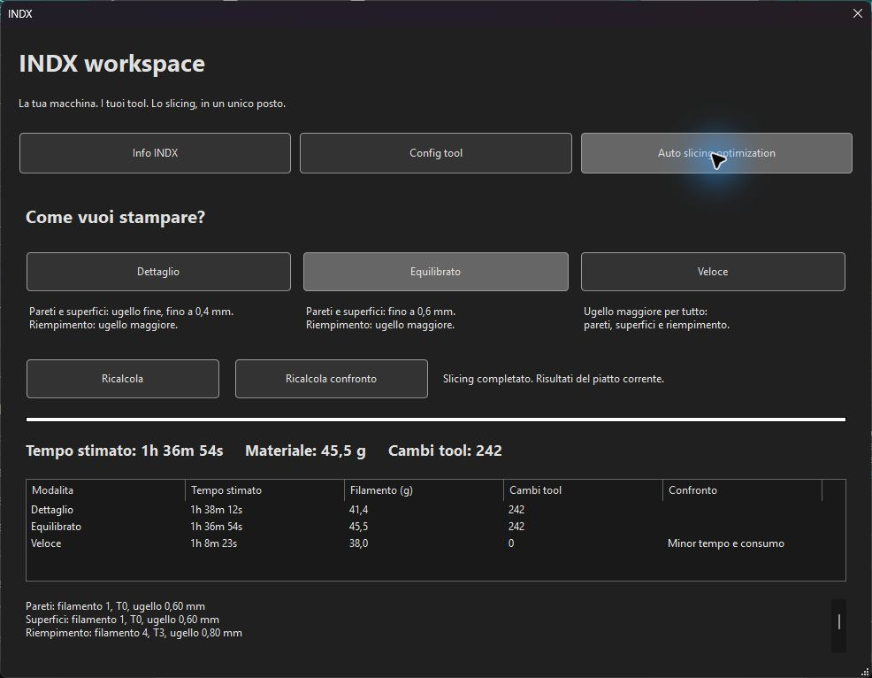

# INDX Studio e profilo Performance

Aggiornamento del 17 ottobre 2026. Il touch della SV08 Max usa ora il tema globale `indx-studio` e il nuovo spazio INDX. Non è un fork completo di ogni pannello standard di KlipperScreen: il tema si applica all'intera applicazione; panoramica, filamenti e configurazione tool hanno anche una nuova disposizione dei comandi.

## Sul touchscreen

Correzione dimensioni display: scala esplicita anche per i testi interni dei controlli GTK, margini esterni ridotti e contenitore finale scorrevole. Verificato con i pulsanti reali KlippyGtk, font di sistema 32 px e spazio riservato a barra titolo e comandi laterali, a 1024×600 e 1280×800. Il pulsante di conferma Filamenti rimane entro l'area visibile; i campi successivi si raggiungono scorrendo.

- **Panoramica:** schede Tn con diametro, Standard/CHT, filamento assegnato e stati PA/flow/portata. Una spunta richiede una calibrazione ancora valida, non il semplice salvataggio di un numero. Lo stato montaggio confermato indica la dichiarazione salvata, non il completamento del collaudo fisico.
- **Navigazione laterale:** rimane visibile fra le otto pagine. Selezionare un tool o aprire una pagina non aggancia la testa.
- **Filamenti:** scelta della base a sinistra, colore e temperature a destra, pulsante di conferma sempre visibile. Il colore è un campione visivo: toccarlo apre la palette GTK. Non compaiono il campo HEX o pulsanti con i nomi dei colori. La panoramica mostra un piccolo campione al posto del codice. Marca e materiale rimangono elenchi dipendenti. Il nome si sceglie alla conferma.
- **Tool e dock:** schede separate per ugello, dock, offset e percorso; salvataggio e test fisici in aree distinte. Per raggiungere i campi successivi scorrere il contenuto.
- **Tema globale:** grafite, verde acqua, contrasti e campi ampi, pulsanti arrotondati, stesso aspetto anche nei pannelli standard. Rimangono le conferme delle azioni fisiche.

Installazione verificata sulla macchina: solo KlipperScreen riavviato, Klipper e Moonraker attivi. Controllo degli hash prima/dopo: configurazioni `.cfg`, libreria, assegnazioni, calibrazioni e montaggio invariati. Backup dei pannelli, configurazione e tema precedenti disponibile per rollback. Il display reale è 1280×800; le immagini dei pannelli sono rendering GTK isolati con dati di prova, non prove di hardware montato.

## Accelerazioni più alte

Il nuovo processo **0.20mm INDX - Performance** è installato localmente e impostato come predefinito del profilo stampante. Base ottimizzata e Collaudo rimangono selezionabili.

| Funzione | Velocità obiettivo mm/s | Accelerazione obiettivo mm/s² |
|---|---:|---:|
| Generale | — | 8000 |
| Pareti esterne | 100 | 3000 |
| Pareti interne | 200 | 6000 |
| Riempimento | 250 | 8000 |
| Solido interno | 180 | 5000 |
| Superficie superiore | 70 | 2000 |
| Spostamenti | 400 | 12000 |

Primo strato 25 mm/s, riempimento primo strato 30 mm/s. I parametri dei ponti restano quelli del processo precedente; le accelerazioni espresse in percentuale seguono la nuova accelerazione generale. PA e portata dei filamenti non aumentano automaticamente. Nel progetto di prova la portata rimane 8 mm³/s su tutti i filamenti.

Il processo [profilo-performance.json](profilo-performance.json) richiede il profilo stampante della preview. Per riprodurre i risultati su un'altra installazione, impostare anche i limiti **dello slicer**: accelerazione massima X/Y, estrusione e travel 12000 mm/s²; velocità massima X/Y 400 mm/s. Per Klipper il controllo dei limiti di Orca usa lo stesso tetto anche per gli spostamenti: il limite di processo in stampa resta 8000 o inferiore. Non copiare questi valori automaticamente nel firmware.

Sovol dichiara 700 mm/s e 40000 mm/s² per la macchina originale: [fonte ufficiale Sovol](https://www.sovol3d.com/blogs/news/how-sovol-sv08-max-solves-3d-printing-issues-headaches). Non sono misure del montaggio INDX. La scelta 8000/12000 è una variante proposta per il collaudo, non un limite meccanico certificato. Input shaping, cinghie, percorso PTFE, aggancio e qualità superficiale devono essere verificati sul montaggio reale. Le [modalità di cambio tool Bondtech](https://github.com/BondtechAB/INDX/blob/main/README.md#speed--acceleration) mantengono i propri limiti runtime; nessuna modifica alle macro o al firmware della macchina in manutenzione.

## Slicing nativo sullo stesso modello

| Modalità | Base 3000 | Performance | Riduzione | Consumo invariato | Cambi invariati |
|---|---:|---:|---:|---:|---:|
| Dettaglio | 1h 47m 48s | 1h 38m 12s | 9m 36s | 41,4 g | 242 |
| Equilibrato | 1h 43m 26s | 1h 36m 54s | 6m 32s | 45,5 g | 242 |
| Veloce | 1h 09m 44s | 1h 08m 23s | 1m 21s | 38,0 g | 0 |

Stime, non tempi fisici. Identica geometria, filamenti, torre, diametri 0,6/0,4/0,6/0,8 e assegnazione automatica. Il limite di portata spiega perché le velocità nominali maggiori non dimezzano i tempi. Il G-code Equilibrato è stato esportato senza stamparlo: accelerazione massima dei comandi 12000 mm/s², valori di processo corretti e portata 8/8/8/8. Non compare più l'avviso di accelerazione oltre il limite del profilo; restano gli avvisi sperimentali originali su torre e multidiametro.

## Verifiche e ripristino

GTK reale sullo SPI-XI, in isolamento: parsing CSS insieme allo stile base, otto pagine a 1024×600 e 1280×720, 1/4/8/12 tool, nessuna espansione oltre lo schermo, propagazione del tool selezionato. Test del selettore filamenti: filtro marca/materiale, annullamento senza scritture, conferma nome, rinomina con identità stabile e integrazione dashboard. Installer: verifica pacchetto, installazione ripetuta e rollback esatto di moduli/configurazione/tema, dati calibrati più recenti conservati.

Usare `install_klipperscreen.py` e le istruzioni del repository per installare o ripristinare. Il tema può essere cambiato dalle impostazioni standard di KlipperScreen. Il rollback può lasciare la cartella del tema e il collegamento alle icone originali, ma ripristina il CSS precedente e la selezione originale del tema. Non rimuove dati di filamenti o calibrazioni.

La guida PDF completa comprende la nuova panoramica e una pagina dedicata al profilo Performance.
