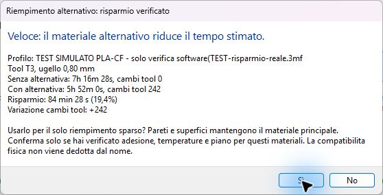
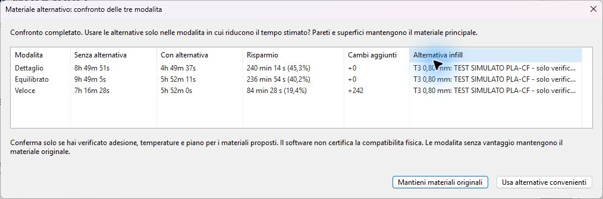
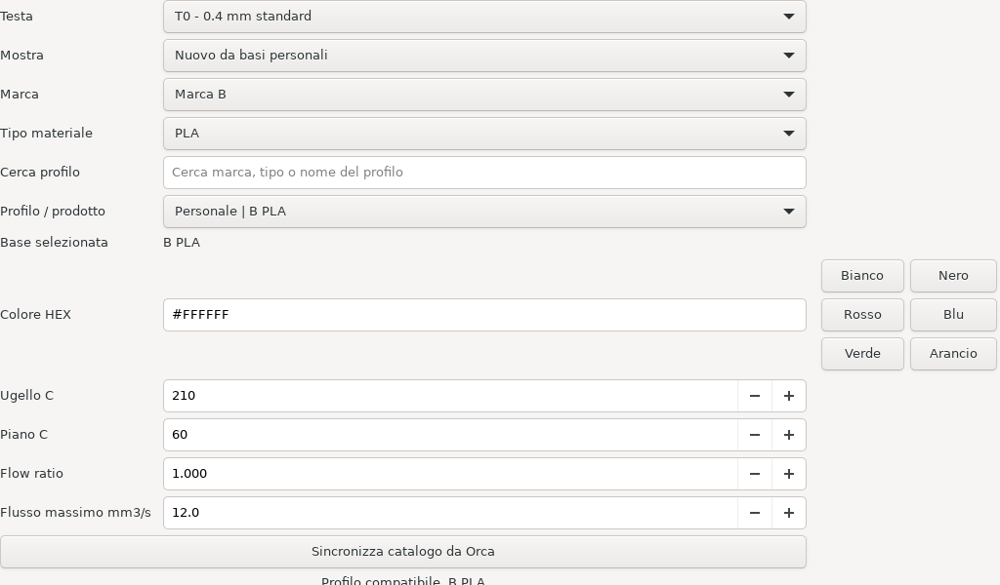

# Preview 0.3.0 - interfaccia diretta e configurazione dalla stampante

## Colori e filamenti

Campione colore anche in Orca, aggiornamento automatico delle assegnazioni dal touch al progetto e due scelte sul touch: **Usa valori standard** oppure **Salva personalizzato**. I valori standard provengono dalla base Orca selezionata; non vengono dichiarati calibrati. [Uso e verifiche](FILAMENTI_STANDARD_PERSONALIZZATI.md).

## INDX Studio e Performance

Nuova panoramica tool, navigazione laterale, filamenti a schede con conferma sempre visibile e tema globale KlipperScreen. Disponibile il processo Performance da collaudare: stampa fino a 8000 mm/s² e travel 12000 mm/s² / 400 mm/s. [Interfaccia, installazione e risultati](INDX_STUDIO_PERFORMANCE.md).

## Base di stampa più rapida

Disponibile **0.20mm INDX - Base ottimizzata**: pareti 60/110 mm/s, infill 150, superfici superiori 50, travel 200; accelerazioni fino a 3000 mm/s². Primo strato, portata e PA conservati. Il collaudo fisico resta necessario. [Valori, confronto prima/dopo e importazione](PROFILO_BASE_OTTIMIZZATA.md).

## Un solo punto di inserimento

In KlipperScreen aprire INDX. **Panoramica** mostra tool e calibrazioni. La navigazione laterale **Filamenti, Tool e dock, Pressure advance, Flow ratio, Portata massima, Collaudo, Cambia tool** cambia il contenuto della stessa area. Le schede T0, T1 e successive selezionano il tool da modificare. Standard/CHT e direzione dock sono interruttori diretti.

In Orca il pulsante **INDX** apre uno spazio unico con tre pulsanti di selezione: **Info INDX**, **Config tool**, **Auto slicing optimization**. Non c'e un secondo editor connessione INDX: viene usata la connessione della stampante configurata nella sezione superiore di Orca. Le connessioni della preview precedente restano utilizzabili durante la migrazione.

## Aggiungere tool, dock e offset

1. In **Tool e dock**, ricaricare la configurazione e aumentare **Numero tool**. Il limite software e 1-64; non e una capacita fisica certificata.
2. Selezionare ogni nuova scheda Tn. Impostare diametro, Standard/CHT, fattore CHT, Dock X, Dock Y e offset X/Y/Z. Le quote nuove restano vuote finche non vengono inserite; non si generano dock da un passo presunto.
3. Verificare direzione dock, corsia libera Y, distanza ingresso e Z-hop. **Leggi posizione attuale per il dock** legge X/Y senza muovere e richiede assi referenziati.
4. **Salva bozza senza applicare** conserva dati anche incompleti. **Verifica e salva configurazione** richiede dati completi, macchina libera, target termici spenti, quote entro i limiti del profilo e corsia ad almeno 26 mm sul lato esterno ai dock. Non amplia le corse.
5. Il salvataggio modifica il file utente `indx/indx.cfg`, aggiunge i comandi Tn mancanti, conserva un backup e invalida il precedente collaudo. Non cambia i file ufficiali del meccanismo, non muove assi e non esegue flash.
6. **Riavvia Klipper per caricare** richiede macchina ferma e riscaldatori spenti. La riga di stato distingue salvato e caricato. Il profilo manutenzione non attiva INDX: il caricamento reale richiede il profilo INDX con testa e cella presenti.
7. Dopo le misure reali, selezionare la dichiarazione dell'operatore e usare **Conferma dock misurati: abilita test**. I test di aggancio/parcheggio richiedono la conferma del movimento e usano le macro esistenti.
8. In **Collaudo**, completare in ordine i primi sei passaggi fisici: collegamenti, dock, aggancio, pulizia, Z, XY. Solo dopo si puo dichiarare il collaudo per la stampa in Tool e dock. La stampa di prova e il settimo passaggio, da verificare dopo averla eseguita.

Gli offset sono i valori assoluti Klipper del tool, non incrementi. Sono registrati una sola volta per revisione tramite `SAVE_VARIABLE`; i riavvii successivi non cancellano le calibrazioni ufficiali fatte dopo. Il global Z offset resta separato. Le vecchie varianti filamento/calibrazione restano archiviate; rimuovendo tool occorre riassegnare le funzioni dei vecchi progetti.

## Sincronizzazione con Orca

Orca importa automaticamente numero, diametri, Standard/CHT e fattore CHT dalla dichiarazione confermata del touchscreen, circa ogni 15 secondi oltre alla rete. Attende durante modifiche non salvate ai profili, slicing/export e finestre modali. Risposte incomplete, offline o di una connessione precedente non ridimensionano il profilo. Le copie precedenti del profilo stampante sono conservate in `indx-profile-backups`.

In **Config tool**, **Sincronizza filamenti nel progetto** importa le assegnazioni nel piatto corrente e i parametri del profilo personale: colore, temperature, PA, flow e portata. Chiede conferma se una copia generata e stata modificata localmente. Salvare il progetto e rislicera dopo i cambi; il G-code gia esportato non cambia.

## Filamenti e calibrazioni

La libreria stampante separa profili personali e basi generiche. Le calibrazioni sono legate a filamento, tool, diametro, Standard/CHT e condizioni del test. **Verificato** indica un test visivo/manuale salvato con condizioni corrispondenti; **stimato**, **da calibrare** e **da rifare** restano distinti. Rinominare o cambiare colore conserva l'identita; modificare temperatura, materiale/prodotto o flow puo invalidare i test dipendenti.

PA, flow e portata richiedono il test corrispondente completato prima del salvataggio. La scelta del campione e visiva: la cella non misura automaticamente PA o qualita del flusso. Il massimo flusso salva il 90% dell'ultima fascia scelta senza difetti. Le stime CHT generiche non sono misure della macchina.

## Controlli e multidiametro

**Controlla il piatto corrente** legge uno stato nuovo e confronta i tool effettivamente usati. Tool montati ma inutilizzati non impongono il limite di layer. L'invio INDX controllato resta limitato al piatto corrente tramite stampante fisica Moonraker; offline slicing/export sono disponibili, ma un file esportato separatamente non e certificato dal controllo.

In **Auto slicing optimization**, i selettori **Dettaglio, Equilibrato, Veloce** applicano una proposta in un processo separato. Materiali diversi e override locali richiedono assegnazioni manuali. Pareti da 0,20 mm e infill da 0,80 mm possono usare base 0,14 mm e accorpamento infill 0,56 mm dove la geometria lo consente. L'altezza segue i tool usati; non aumenta una richiesta piu fine. In anteprima usare Altezza strato e le proprieta del movimento selezionato.

## Backup e guide

`indx-machine-backup-*` conserva i file geometrici precedenti; `indx-profile-backups` conserva profili e dati; `indx-screen-backup-*` conserva software e menu. Il rollback software dell'installatore mantiene i dati filamento/calibrazione attuali. Non ripristina automaticamente una vecchia geometria o un collaudo fisico.

Guida completa illustrata: [Guida_completa_INDX_Orca_KlipperScreen.pdf](Guida_completa_INDX_Orca_KlipperScreen.pdf). Risultati: [TEST_PREVIEW_03.md](TEST_PREVIEW_03.md). I limiti e le quote non vengono misurati automaticamente.

## Ottimizzazione automatica: filamenti identici e pareti fini

La proposta legge i preset e la mappatura attuali del piatto. Se sono presenti almeno tanti filamenti quanti i tool, tutti dello stesso tipo e colore, una mappatura predefinita vuota, tutta sul primo tool o gestita da una modalita automatica Orca viene completata automaticamente: filamento 1 su T0, filamento 2 su T1 e cosi via. Una mappatura personalizzata non predefinita viene preservata.

Dettaglio sceglie l'ugello piu fine e richiede pareti da 0,4 mm o meno. Con T0=0,6, T1=0,4, T2=0,6 e T3=0,8, propone T1 per pareti e superfici. Dettaglio usa comunque il maggiore ugello per infill. Equilibrato sceglie il maggiore fino a 0,6 mm per pareti e superfici e il maggiore disponibile per infill. Con questo montaggio: Dettaglio 0,4/0,8 ed Equilibrato 0,6/0,8. Uno 0,2 associato prevale sullo 0,4 per Dettaglio. Tutti i tool diventano disponibili alla scelta; non viene imposto di usare ugelli equivalenti, aggiungendo cambi inutili.

Se manca il filamento per un ugello fine montato, la proposta lo segnala anziche sostituirlo con uno 0,6 e chiamarlo Dettaglio. Materiali/colori diversi non vengono rimappati automaticamente. Il software non dichiara carichi fisici o calibrazioni per effetto della proposta. Salva il progetto e rislicera.

## Veloce: ugello maggiore per tutte le funzioni proposte

Veloce assegna pareti, superfici e riempimento al maggiore ugello disponibile tra i filamenti associati. Con 0,6/0,4/0,6/0,8 usa T3 da 0,8 per tutte queste funzioni. Dettaglio resta 0,4/0,8 ed Equilibrato 0,6/0,8. I supporti e le parti dipinte mantengono le assegnazioni esplicite esistenti. Il limite Z continua a dipendere dai tool effettivamente usati e non aumenta una richiesta di layer piu fine.

## Workspace INDX e slicing nella stessa pagina

I tre pulsanti principali sono Info INDX, Config tool e Auto slicing optimization. La home presenta solo le informazioni INDX; non contiene risultati di slicing o parametri di calibrazione. Config tool mostra il montaggio ricevuto dal touchscreen e conserva il comando di sincronizzazione filamenti senza la tabella delle calibrazioni.

In Auto slicing optimization scegli Dettaglio, Equilibrato o Veloce: il cambio di modalita applica la proposta e avvia il motore nativo Orca senza chiudere la finestra o cambiare pagina. La stessa area mostra avanzamento, assegnazioni, tempo stimato, materiale e cambi tool. Rilanciare la stessa proposta riusa il processo; un profilo modificato non viene sovrascritto.

Il cambio modalita nasconde i risultati precedenti. Il nuovo calcolo parte automaticamente nella stessa pagina; Ricalcola resta disponibile per ripetere una prova o recuperare dopo un errore. Piatto cambiato o risultato invalidato nascondono le metriche. Eventuali errori nativi restano nelle notifiche Orca e il pannello invita a correggere e riprovare. Nessuna stampa viene avviata dal pulsante di slicing.

## Confronto delle tre modalita

La pagina Auto slicing optimization conserva nella stessa tabella tempo stimato, filamento in grammi e cambi tool per Dettaglio, Equilibrato e Veloce. Le righe mancanti sono Da calcolare. Gli indicatori Minor tempo e Minor consumo confrontano i risultati disponibili; non valutano la qualita del pezzo.

Aprire **Auto slicing optimization** avvia automaticamente tre slicing nativi in sequenza; **Ricalcola confronto** permette di ripeterli, terminando con la modalita inizialmente selezionata. Anche il normale cambio di modalita aggiorna la relativa riga. Il confronto viene conservato durante la sessione del pannello; chiudendo il pannello occorre ricalcolarlo. Una modifica a piatto, modello, montaggio, filamento o parametri invalida i risultati. I tempi sono stime del motore Orca e il consumo comprende cio che Orca conteggia nel piatto, inclusa la torre se presente.

## Materiale alternativo: proposta solo dopo il confronto dei tempi

Per ogni modalita Orca calcola prima il piatto con il materiale principale, poi con ciascuna alternativa di un altro colore dello stesso tipo oppure di una coppia documentata con condizioni (PETG/TPU o PLA/TPU) su ugello maggiore. PLA/PETG e PLA/ABS sono escluse come alternative strutturali anche se piu veloci. Il menu Filamento principale sceglie esplicitamente la base e avvia il confronto. Pareti e superfici mantengono il materiale assegnato alle pareti esterne (primo slot se automatico). Solo il riempimento sparso cambia nelle prove. Sono esclusi materiali per supporti, tipo sconosciuto e ugelli uguali o piu piccoli del migliore infill principale.

Il riepilogo finale compare solo se almeno un'alternativa, in almeno una delle tre modalita, ha un tempo totale inferiore alla precisione visualizzata (un secondo). Fra piu alternative viene proposta quella piu rapida. La richiesta mostra profilo/tool/diametro, tempo e cambi tool con e senza alternativa, risparmio in minuti/secondi e percentuale, e variazione firmata dei cambi tool. Sono stime native Orca dell'intero piatto, inclusi torre e cambi conteggiati dal motore, non una semplice proporzione fra diametri.

La decisione viene raccolta una sola volta nel riepilogo finale: applica le alternative convenienti al solo infill oppure mantiene tutte le varianti principali. La versione scelta viene rislicerata prima di aggiornare la tabella. Alternative piu lente o equivalenti non generano richieste. Una prova fallita non giustifica una proposta e ripristina la base. Le scelte sono per modalita: un materiale puo convenire in Dettaglio e non in Veloce. Cambiare input invalida le misure; il confronto puo richiedere piu slicing della precedente versione. Durante le prove la modifica del progetto e la chiusura del pannello attendono il completamento, per non lasciare attiva una variante temporanea.

Il controllo nativo INDX usa regole distinte per modello e interfaccia, incluse assegnazioni locali e pittura. Le coppie rigido/flessibile documentate sono ammesse con condizioni visibili; PLA/PETG sono ammesse solo nel ruolo di supporto. I materiali caricati ma inutilizzati non bloccano la stampa; i filamenti dedicati ai supporti sono separati da questa regola. Il colore alternativo richiede una conferma esplicita. Supporti, pittura e assegnazioni locali conservano le regole precedenti. Nessuna prova software avvia la stampante.

## Una sola richiesta alla fine delle tre modalita

Orca completa prima tutte le prove base/alternativa di Dettaglio, Equilibrato e Veloce. Solo alla fine mostra un unico riepilogo con, per ciascuna modalita, tempo senza/con alternativa, risparmio in minuti/secondi e percentuale, cambi tool aggiunti e profilo/tool proposto. Le alternative piu lente sono indicate come Non conviene; se nessuna conviene non compare alcuna domanda.

**Usa alternative convenienti** applica l'alternativa solo alle righe con vantaggio, poi ricalcola i risultati finali. **Mantieni materiali originali**, predefinito, conserva le tre basi. Cambiare modalita riusa la decisione finche gli input restano uguali; Ricalcola o Ricalcola confronto avviano una nuova valutazione completa. Chiudere il pannello o cambiare progetto/parametri invalida il riepilogo.

## Filamenti sul touch: selezione dagli elenchi

In Filamenti scegli il tool e Mostra (i tuoi filamenti oppure nuove basi Orca/personali). **Marca** e **Tipo materiale** sono elenchi ricavati dal catalogo compatibile sincronizzato e dalla libreria personale: selezionarli filtra **Profilo / prodotto**. Non si compilano a mano; la base selezionata resta leggibile. Se manca la marca, sincronizza il catalogo con Orca aperto; le basi Generic restano disponibili dove presenti nel catalogo.

Imposta colore e condizioni, poi premi **Conferma filamento e scegli nome**. Il nome personale viene richiesto a quel punto: puoi accettare il suggerimento o rinominarlo e premere **Salva e assegna**. Annulla non scrive dati. Richiamare o rinominare un profilo personale mantiene la stessa identita e le calibrazioni valide. La lista iniziale mostra le basi se non hai ancora filamenti personali.

## Consigli materiali e interfacce

In Auto slicing optimization aprire Materiali e supporti: candidati caricati, alternative consigliate, condizioni e fonti datate. Usa per l’interfaccia applica solo coppie consigliate e disponibili, senza cambiare i profili filamento globali. Vedere COMPATIBILITA_MATERIALI.md per matrice, supporti solubili, HIPS condizionale e limiti sui compositi.

## Riapertura e modalita non disponibili

Il colore predefinito riscritto dall’importazione 3MF non genera un falso conflitto sulle impostazioni del profilo: il colore effettivo dello slot resta sincronizzato separatamente. Modifiche reali a PA, flow e temperature restano protette. Una modalita priva dell’ugello richiesto viene indicata come Non disponibile e il confronto prosegue con le altre; non vengono inventati risultati per la modalita mancante.

## 17 ottobre — mappatura nella pagina principale

Automatico / Manuale accanto a INDX, selettore Tool sotto ogni filamento, rispetto della mappa manuale in Auto slice. [Verifica con il filamento 2](PROVA_MAPPATURA_TOOL.md). Sezione del risultato scelto e panoramica Mainsail documentate nella guida completa.

## Ugelli direttamente nella pagina principale

[Automatico / Manuale per diametro e Standard/CHT](UGELLI_MANUALI_AUTOMATICI.md). Scelta separata dalla mappatura dei filamenti; in Manuale gli ugelli locali non vengono sostituiti dal polling.
