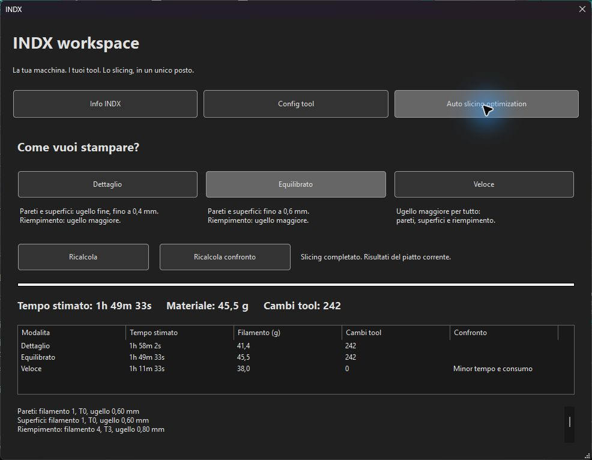
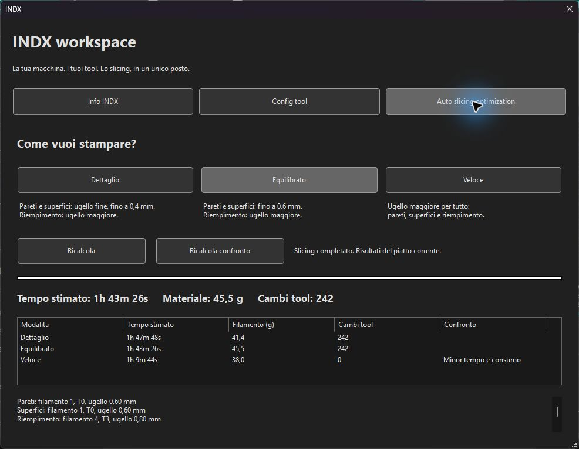

# Base INDX: velocità e accelerazioni

Nuovo processo **0.20mm INDX - Base ottimizzata**, installato nello slicer locale e impostato come processo predefinito della SV08 Max INDX. Il profilo Collaudo resta disponibile. Il confronto è del 17 ottobre 2026 e riguarda stime dello slicer, non tempi misurati sulla stampante.

## Impostazioni

| Funzione | Velocità prima → dopo (mm/s) | Accelerazione prima → dopo (mm/s²) |
|---|---:|---:|
| Parete esterna | 50 → 60 | 1000 → 1500 |
| Parete interna | 70 → 110 | 3000 → 3000 |
| Riempimento | 80 → 150 | 2000 (100%) → 3000 |
| Riempimento solido interno | 70 → 100 | 1000 (50%) → 2000 |
| Superficie superiore | 40 → 50 | 1000 → 1000 |
| Spostamenti | 150 → 200 | 3000 → 3000 |

Accelerazione generale: 2000 → 3000 mm/s². Primo strato 25 mm/s e relativo riempimento 30 mm/s conservati; ponti, PA, portata dei filamenti e macro conservati. Il limite di portata nel progetto di prova rimane 8 mm³/s per ogni filamento: le velocità indicate sono obiettivi, ridotti dallo slicer quando la portata non basta.

## Confronto nativo sullo stesso progetto

Stessa geometria, stessi quattro filamenti, stessa torre di spurgo e stessi parametri multidiametro. Montaggio del progetto: 0,6 / 0,4 / 0,6 / 0,8 mm. Cambiano esclusivamente le velocità e le accelerazioni elencate sopra.

| Modalità | Prima | Dopo | Risparmio stimato | Filamento prima/dopo | Cambi tool prima/dopo |
|---|---:|---:|---:|---:|---:|
| Dettaglio | 1h 58m 02s | 1h 47m 48s | 10m 14s (8,7%) | 41,4 g | 242 |
| Equilibrato | 1h 49m 33s | 1h 43m 26s | 6m 07s (5,6%) | 45,5 g | 242 |
| Veloce | 1h 11m 33s | 1h 09m 44s | 1m 49s (2,5%) | 38,0 g | 0 |

Esportato anche il G-code Equilibrato: valori di accelerazione effettivi 750, 1000, 1500, 2000 e 3000 mm/s², inclusi i rallentamenti locali; nessun comando di accelerazione oltre 3000. Le impostazioni esportate riportano pareti 60/110, infill 150, travel 200 e portata 8/8/8/8. Nessun file è stato inviato in stampa.

## Uso e limiti

Selezionare il processo **0.20mm INDX - Base ottimizzata**, poi aprire INDX → Auto slicing optimization. L'ottimizzatore crea i processi derivati e conserva queste velocità nelle tre modalità. Nei progetti già salvati selezionare esplicitamente la nuova base: Orca conserva i parametri incorporati nei vecchi 3MF.

Il file importabile è [profilo-base-ottimizzata.json](profilo-base-ottimizzata.json). Richiede il profilo stampante SV08 Max INDX della preview e il preset Sovol da cui eredita. Importare da File → Importa → Importa configurazioni, quindi scegliere il nuovo processo. Non contiene configurazione della connessione o dati personali.

Questi valori sono una base da collaudare sul montaggio reale. Non certificano qualità delle superfici, input shaping, PA o portata. La macchina è ancora in manutenzione: questo aggiornamento non modifica il firmware né abilita il movimento. I limiti effettivi dovranno essere validati durante il collaudo INDX. Le stime non rappresentano la durata fisica di una stampa con limiti di manutenzione.

Le velocità di aggancio/parcheggio sono separate: le modalità ufficiali INDX dipendono dai limiti runtime di Klipper. Riferimento: [manuale ufficiale Bondtech INDX](https://github.com/BondtechAB/INDX/blob/main/README.md). Questo aggiornamento non modifica tali macro o modalità.

Per tornare indietro selezionare il precedente processo Multidiametro o Collaudo. Il progetto e i preset locali precedenti sono stati salvati in una cartella di backup datata prima dell'aggiornamento.
