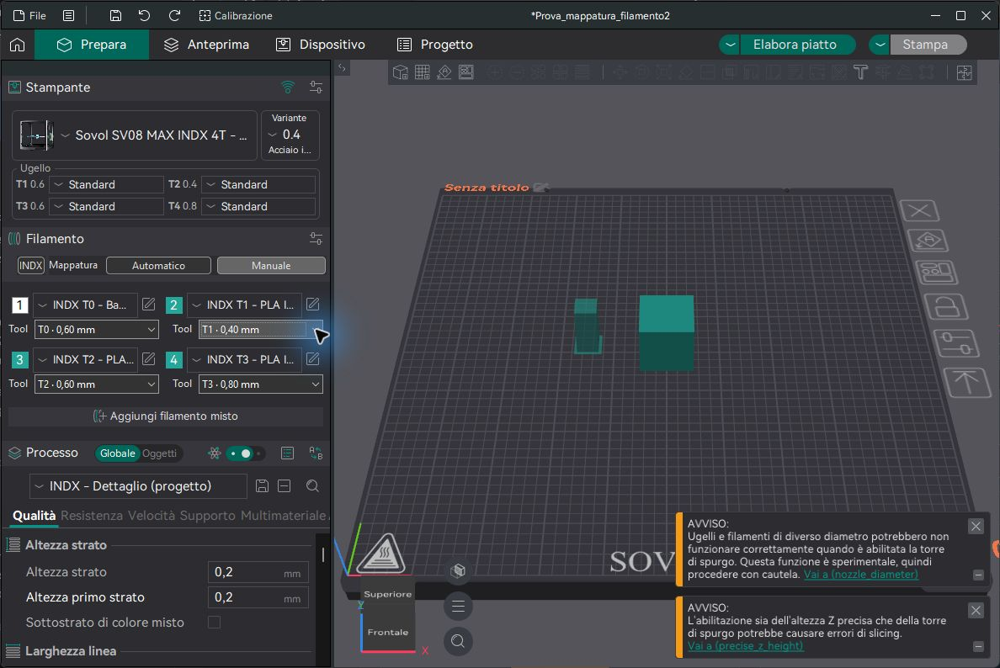
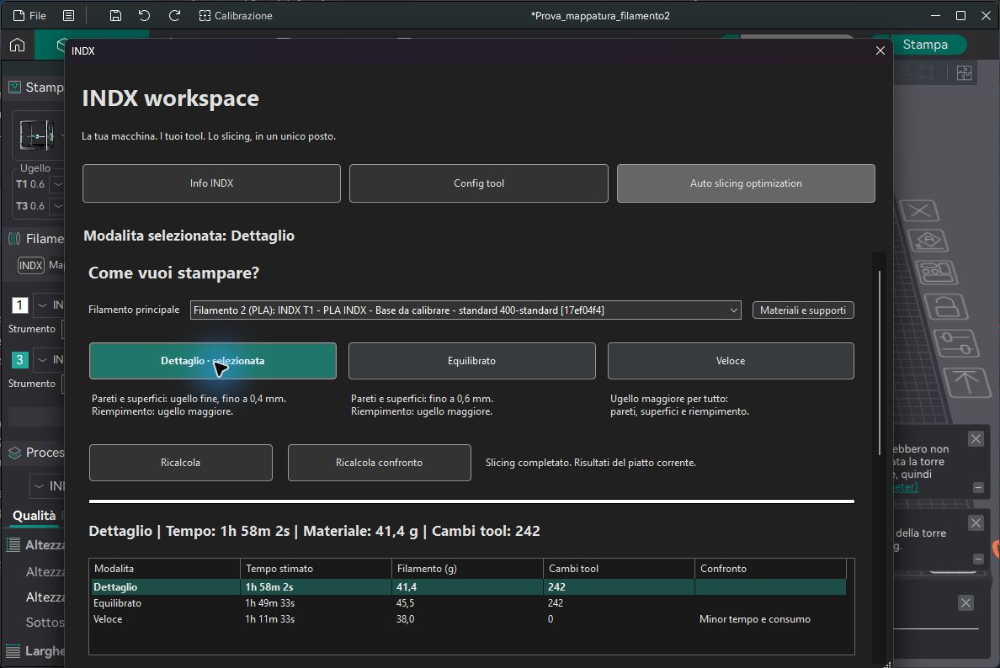

# Mappatura filamenti e tool — verifica del 17 ottobre 2026

Nella sezione principale Filamenti sono disponibili i pulsanti **Automatico** e **Manuale**. Ogni filamento mostra direttamente il proprio tool e il diametro, senza aprire INDX o altri sottomenu.

- **Automatico:** con uno slot per tool, il filamento 1 corrisponde a T0, il filamento 2 a T1 e cosi via. I selettori mostrano il risultato e sono disabilitati.
- **Manuale:** abilita il selettore Tool sotto ogni filamento. Auto slice conserva queste assegnazioni, comprese piu assegnazioni allo stesso tool. La mappa viene salvata nel progetto 3MF; la preferenza Automatico/Manuale viene conservata per stampante.
- Il numero dei selettori deriva dai filamenti presenti e le scelte dal montaggio configurato: non e limitato a quattro tool.

## Errore corretto

Una mappa iniziale [1,1,1,1] poteva restare bloccata sul primo tool quando uno slot aveva colore o materiale diverso. Il secondo filamento, pur assegnato a un ugello da 0,4 mm, non diventava un candidato per Dettaglio. La ricostruzione automatica ora risolve la posizione prima della selezione dei tool. Le regole di compatibilita tra materiali restano separate e attive.

## Verifica nel programma

Montaggio dichiarato: 0,6 / 0,4 / 0,6 / 0,8 mm. Selezionato il secondo filamento PLA come principale; il primo filamento ABS non viene usato per il modello PLA. Il confronto nativo ha completato tutte le modalita:

| Modalita | Tempo stimato | Materiale | Cambi tool |
|---|---:|---:|---:|
| Dettaglio | 1h 58m 2s | 41,4 g | 242 |
| Equilibrato | 1h 49m 33s | 45,5 g | 242 |
| Veloce | 1h 11m 33s | 38,0 g | 0 |

Sono stime dello slicer per il modello di prova, non misure di stampa. Verificato anche il cambio manuale del secondo filamento da T1 a T2 e ritorno a T1, poi il ripristino Automatico. Nessun movimento o riscaldamento.

## Regressioni

- libslic3r_tests [IndxChecks]: 479 asserzioni, 22 casi.
- fff_print_tests [INDX],[GCodeWriter]: 1494 asserzioni, 43 casi.
- Totale: 1973 asserzioni, 65 casi superati. Build Release completata.
- Inclusi casi con colori diversi, materiale principale nel secondo slot, mappa manuale esplicita e controlli dei materiali incompatibili.

Il kit INDX deve ancora essere collaudato fisicamente: questa modifica risolve l'associazione software e non dichiara hardware presente o calibrazioni effettuate.
