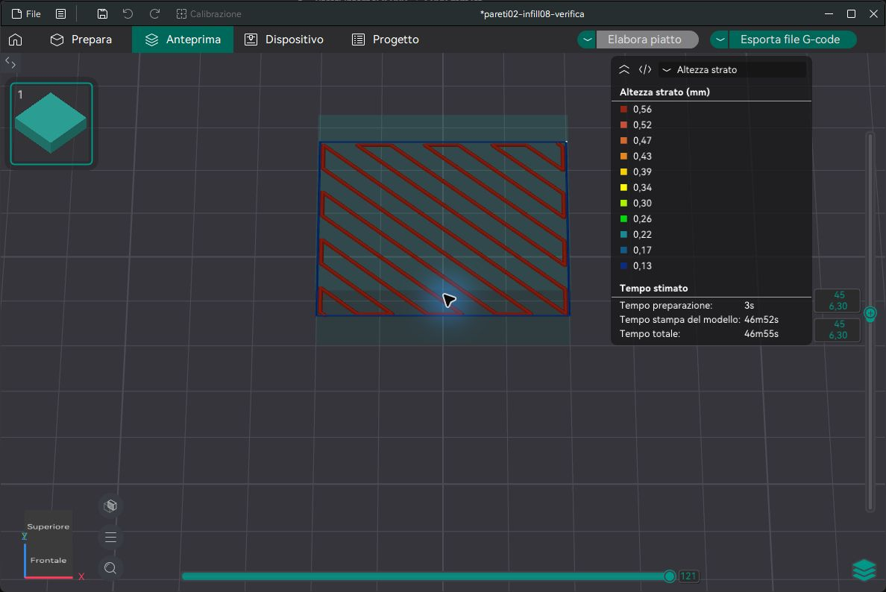

# OrcaSlicer INDX - SV08 Max preview

Integrazione sperimentale tra una build personalizzata di **OrcaSlicer** e **KlipperScreen** per una Sovol SV08 Max convertita a Bondtech INDX.

**Target attuale: SV08 Max + INDX, numero di tool configurabile, un solo feeder e riscaldatore fisico.** Il supporto ad altre stampanti e un obiettivo futuro, non una compatibilita gia verificata. Il progetto non e una release ufficiale OrcaSlicer, Bondtech, Sovol o KlipperScreen.

## Preview 0.3.0

**Interfaccia diretta su Orca e KlipperScreen, con pulsanti di selezione al posto dei sottomenu.** Numero tool, diametri, Standard/CHT, dock e offset si gestiscono dal touchscreen. Orca riceve il montaggio e mostra i dati nello spazio INDX; la connessione resta nella sezione stampante.

- [Guida completa illustrata al software](Guida_completa_INDX_Orca_KlipperScreen.pdf)
- [Profili per diametro ugello e altezza layer](PROFILI_ORDINATI.md)
- [Procedura e nuovi comandi](NUOVE_FUNZIONI.md)
- [Verifiche della preview 0.3](TEST_PREVIEW_03.md)

Il pannello macchina salva bozze, controlla quote e stato, crea backup e distingue configurazione salvata da caricata. Le conferme di dock e collaudo sono dichiarazioni esplicite dell'operatore; non sono misure automatiche. L'installazione non le abilita e non esegue movimenti o flash.

```sh
python verify.py
python install_klipperscreen.py --check
```

L'installatore supporta `--rollback PERCORSO_BACKUP` con le directory KlipperScreen/config. Il ripristino riguarda software e menu e mantiene filamenti/calibrazioni attuali.

La selezione di filamento e colore si sincronizza **nei due sensi** fra Orca e KlipperScreen. La panoramica mostra anche i valori standard; le pagine touch mantengono le bozze e riusano i dati in memoria. Dettagli e prove in [Colori e filamenti](FILAMENTI_STANDARD_PERSONALIZZATI.md). Per attivare il servizio Linux aggiungere `--sync-service` ai percorsi di installazione e `--restart`; il servizio viene incluso nel rollback.

## Funzioni

- Libreria separata dei propri filamenti, con UUID stabile, nomi modificabili, marca, materiale e colore.
- Temperature ugello/piano, PA, flow ratio e massimo flusso volumetrico richiamabili senza reinserire i valori.
- Archivio calibrazioni per **filamento + tool + diametro + Standard/CHT**. Tornando alla stessa combinazione, i risultati vengono recuperati.
- Montaggio configurato una sola volta su KlipperScreen e importato automaticamente in Orca. Lo spazio **INDX > Config tool** mostra la dichiarazione ricevuta. Numero di tool da 1 a 64 (limite software Orca), diametro indipendente per ciascun tool, da 0,10 a 2,00 mm nelle impostazioni software; la disponibilita fisica degli ugelli INDX e separata.
- Stima CHT modificabile per i profili generici: fattore iniziale 1,30. Il massimo flusso misurato prevale sempre sulla stima. Il diametro non viene usato come un moltiplicatore quadratico della capacita di fusione.
- Pulsante **INDX**: catalogo Orca standard/personale, importazione persistente dei profili e assegnazione ai tool del progetto. Salvataggio della libreria in background con Orca aperto.
- Test visivi PA, flow e massimo flusso dal touchscreen. La cella di carico non misura questi risultati.
- Combinazione riempimento INDX: l'ugello del riempimento puo depositare uno strato alto quanto la somma degli strati parete accorpati, entro il proprio limite di altezza. Per esempio, due strati parete da 0,20 mm corrispondono a un riempimento da 0,40 mm. Le intersezioni geometriche e le zone solide restano gestite da Orca.
- G-code adattato al feeder e al riscaldatore condivisi: PA sull'extruder fisico, nessun preriscaldamento degli ugelli parcheggiati.

## Stato e limiti

Anteprima software da testare e perfezionare sulla SV08 Max. Compilazione Windows Release e prove automatiche locali disponibili; la sincronizzazione e stata verificata con un server Moonraker simulato. La costruzione e attivazione GTK sono verificate sullo SPI-XI; i pannelli vengono installati con backup. Il collaudo fisico di stampa resta da eseguire. I dati simulati delle prove sono separati dai dati reali della macchina.

**Nessuna procedura di questo repository esegue flash, convalida pinout, certifica quote dock o abilita automaticamente movimenti.** Homing, pulizia, aggancio, offset e collegamenti devono essere verificati sulla singola macchina. Le macro di commissioning devono bloccare i test finche la macchina non e collaudata.

## Contenuto

| File | Utilizzo |
|---|---|
| `OrcaSlicer-INDX.patch` | Modifiche rispetto al commit ufficiale indicato in `UPSTREAM.json` |
| `prepare_source.py` | Scarica il sorgente ufficiale a quel commit e applica la patch |
| `touchscreen.zip` | Sorgenti dei pannelli, test Python e basi legacy esplicitamente non calibrate |
| `install_klipperscreen.py` | Installazione locale dei pannelli con backup; nessun accesso SSH incluso |
| `test_profiles.py` | Verifiche isolate di libreria, tipi di ugello e generatori di test |
| `PROMPTS.md` | Prompt riutilizzabili per modificare Orca e KlipperScreen |
| `Guida_OrcaSlicer_INDX_SV08Max.pdf` | Guida italiana al funzionamento e al collaudo |
| `INDX_Altezze_layer_esempi_grafici.pdf` | Quattro pagine illustrate: tool inutilizzati, piano Z comune, infill combinato e supporti |
| `LICENSE` | AGPL-3.0, mantenuta dal progetto OrcaSlicer |

## Preparare il sorgente Orca

Richiede Python 3 e Git. In una cartella di lavoro nuova:

```text
python prepare_source.py
```

Il programma crea `upstream-orca`, verifica il commit e applica la patch. Non modifica un checkout preesistente e non installa toolchain o firmware. La compilazione richiede le dipendenze e il compilatore descritti nella documentazione ufficiale OrcaSlicer. Su Windows usare una toolchain C++ completa e una build Release. Compilare anche `fff_print_tests` ed eseguirlo con filtro `[INDX]` e `[GCodeWriter]`.

## Preparare KlipperScreen

Sul computer che esegue KlipperScreen, dopo aver trasferito questa cartella:

```text
python3 test_profiles.py
python3 install_klipperscreen.py --klipperscreen-dir /home/USER/KlipperScreen --config-dir /home/USER/printer_data/config
```

Sostituire USER con l'utente reale. L'installatore crea un backup e compila la sintassi dei moduli. Non verifica pinout, non avvia test fisici e non riavvia servizi senza `--restart`. Prima del riavvio verificare dipendenze GTK e configurazione menu. Il vecchio pannello PA deve essere conservato nel backup per ripristino.

I test fisici richiedono le macro gia collaudate `_INDX_SETUP`, `_INDX_REQUIRE_COMMISSIONED`, `INDX_PRINT_START`, `INDX_PRINT_END` e `CHANGE_TOOL`. L'installatore non le inventa o sostituisce.

## Uso

1. Aprire la build INDX con un profilo stampante INDX con il numero di tool previsto e con impostazioni personali salvate.
2. Su KlipperScreen, in **INDX > Tool e dock**, dichiarare quelli realmente montati. Orca importa numero, diametri e tipi automaticamente; **INDX > Config tool** mostra i dati ricevuti. Standard/CHT e una scelta indipendente dal materiale dell'ugello e dalla variante di estrusore interna di Orca.
3. Configurare la connessione nella sezione stampante di Orca. Usare un indirizzo della propria stampante: il repository non contiene credenziali o indirizzi personali.
4. Sul touchscreen sincronizzare il catalogo, creare il filamento da una base appropriata, impostare colore/temperature e salvarlo con un nome riconoscibile.
5. A macchina collaudata, stampare e valutare i test. Salvare i risultati nel profilo. Per il massimo flusso si conserva il 90% dell'ultima fascia scelta senza difetti.
6. Sincronizzare INDX in Orca per applicare i tool al progetto, salvarlo e rislicera. La sincronizzazione dei dati non modifica un G-code gia esportato.

Quando si cambiano diametro o tipo, le calibrazioni precedenti restano archiviate ma non vengono applicate alla nuova combinazione. Gli aumenti CHT sono stime di partenza: non attestano una prestazione fisica della SV08 Max.

L'altezza strato e il primo strato vengono adattati automaticamente in un processo INDX separato in base agli ugelli **usati nel piatto corrente**, includendo parti dipinte, assegnazioni per altezza, riempimento e supporti. La mappatura filamento/tool viene risolta prima del calcolo. Un ugello montato ma inutilizzato non limita la stampa. Il limite comune e il minore dei limiti dei tool usati (70% del diametro): se usi 0,20 e 0,80 mm, il layer base non supera 0,14 mm; usando solo 0,80 mm, il limite e 0,56 mm. Il limite e un massimo: non aumenta automaticamente una richiesta piu fine. Modificare il modello, i tool o gli ugelli ricalcola il limite e ripristina le altezze richieste quando possibile, se non cambiate manualmente. Il riempimento combinato somma le altezze dei layer base entro il limite del proprio tool, mantenendo le quote Z coordinate per tutta la stampa. Salvare e rielaborare lo slicing dopo i cambi.

## Materiali nell'ottimizzazione automatica

In **Auto slicing optimization > Filamento principale** scegli il filamento del progetto. Pareti, superfici e riempimento vengono assegnati solo a tool dello stesso tipo di materiale. **ABS e PLA non vengono combinati**, anche quando la variante sarebbe piu veloce. Un altro colore dello stesso tipo puo essere proposto per il solo infill dopo il confronto dei tempi e la conferma finale.

La validazione nativa INDX blocca tipi diversi realmente usati dal modello, anche dopo una sincronizzazione o con assegnazioni locali/pittura. Un tool caricato con altro materiale ma inutilizzato non blocca la stampa. I filamenti dedicati ai supporti restano separati da questa regola. [Prova di regressione materiali](PROVA_MATERIALI.md).

## Prova di slicing verificata

Disponibili [rapporto e riproduzione della prova 0,20/0,80 mm](PROVA_MULTIDIAMETRO.md), con [progetto 3MF, G-code e verificatore](prova-multidiametro.zip). Pareti da 0,14 mm e 18 gruppi di infill da 0,56 mm, verificati nell'anteprima e nel volume estruso. Accelerazioni dei profili di prova corrette a 3.000 mm/s2. Si tratta di un test software: nessuna stampa fisica eseguita.



## Riferimenti

- [Sorgente e documentazione OrcaSlicer](https://github.com/OrcaSlicer/OrcaSlicer)
- [Calibrazioni Orca](https://github.com/OrcaSlicer/OrcaSlicer/wiki/Calibration)
- [Bondtech INDX](https://www.bondtech.se/indx-by-bondtech/)
- [Studio Bondtech sulla portata CHT](https://www.bondtech.se/intranet/white-paper-max-flow-rate/)
- [KlipperScreen](https://github.com/KlipperScreen/KlipperScreen)

Lo studio CHT riguarda un hardware specifico: non e una misura di questa conversione. I valori calibrati del proprio filamento e ugello hanno priorita.
