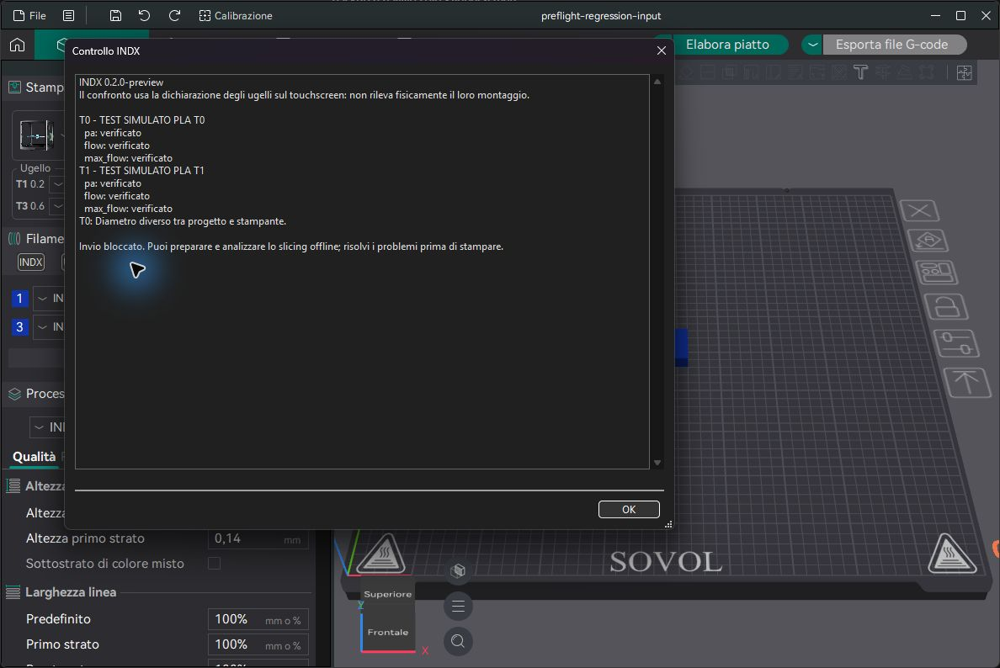
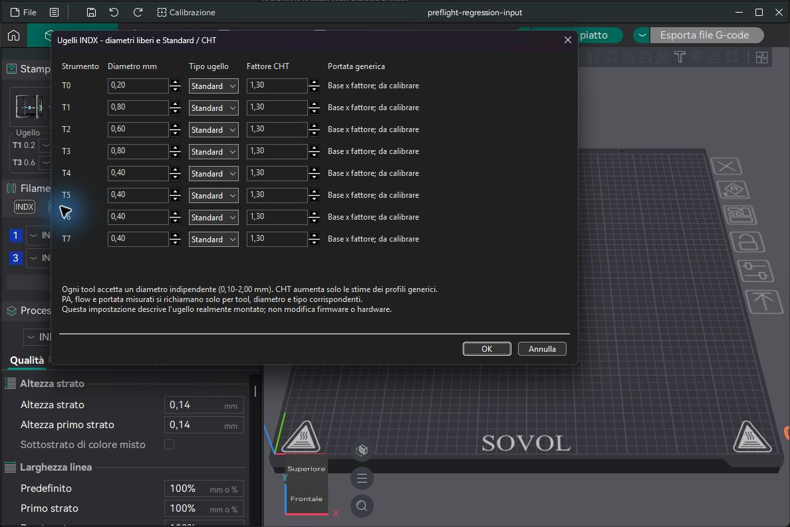

# Verifiche preview 0.2.0

Eseguite il 17 ottobre 2026. Nessuna stampa fisica, movimento o flash effettuato per queste verifiche.

| Prova | Risultato |
|---|---|
| C++ `IndxChecks`, ordine casuale | 129 asserzioni, 5 casi superati |
| C++ `GCodeWriter`, `CombinedInfill`, `UsedLayerTools`, ordine casuale | 467 asserzioni, 38 casi superati |
| Protocollo, catalogo, libreria, condizioni delle calibrazioni | Superati su Windows/Python 3.12 e SPI-XI/Python 3.9.2 |
| Conteggi 1/2/4/8/12/64 | Dichiarazione, archivio, richiamo e rimozione/ripristino verificati; mappatura/limite Z verificati in C++ |
| Separazione catalogo e montaggio fisico | La risposta Orca non sovrascrive la dichiarazione della stampante |
| Installazione, aggiornamento ripetuto e rollback | Superati in directory temporanee su Windows e SPI-XI; dati calibrazione successivi al backup conservati |
| GTK 3 sullo SPI-XI | Costruzione e attivazione dei 6 pannelli con 1/2/4/8/12 tool; dialoghi montaggio annullabili senza modificare i dati |
| Installazione sullo SPI-XI | 9 moduli installati verificati rispetto ai sorgenti provati; backup di codice/config/dati; riavvio del solo KlipperScreen |
| Stato Klipper dopo aggiornamento touchscreen | Ready; processo Klipper invariato; collaudo geometria/pulizia non abilitato dall'installazione |
| Interfaccia Orca con Moonraker simulato | Sincronizzazione e controllo coerente dei soli T0/T1 usati; differenza di diametro T0 segnalata con invio bloccato |
| Dialogo Ugelli in Orca | Passaggio da 4 a 8 tool applicato e salvato nel profilo stampante isolato |

Le immagini seguenti usano dati esplicitamente denominati TEST SIMULATO, in una directory separata dai profili personali. Il controllo verde non attesta il collaudo della stampante reale.

La suite FFF emette anche diagnostica su opzioni/risorse opzionali dei fixture; tutte le asserzioni richieste sono superate. Il controllo clang-tidy previsto dal progetto e stato avviato ma il suo wrapper richiede un'installazione Visual Studio registrata, assente nell'ambiente con toolchain MSVC portabile: non si dichiara quel controllo superato.

Il workflow GitHub verifica il pacchetto Python e gli hash. Non compila Orca e non sostituisce le prove GTK o il collaudo della conversione. La prova multidiametro 0,20/0,80 precedente resta disponibile in [PROVA_MULTIDIAMETRO.md](PROVA_MULTIDIAMETRO.md).
