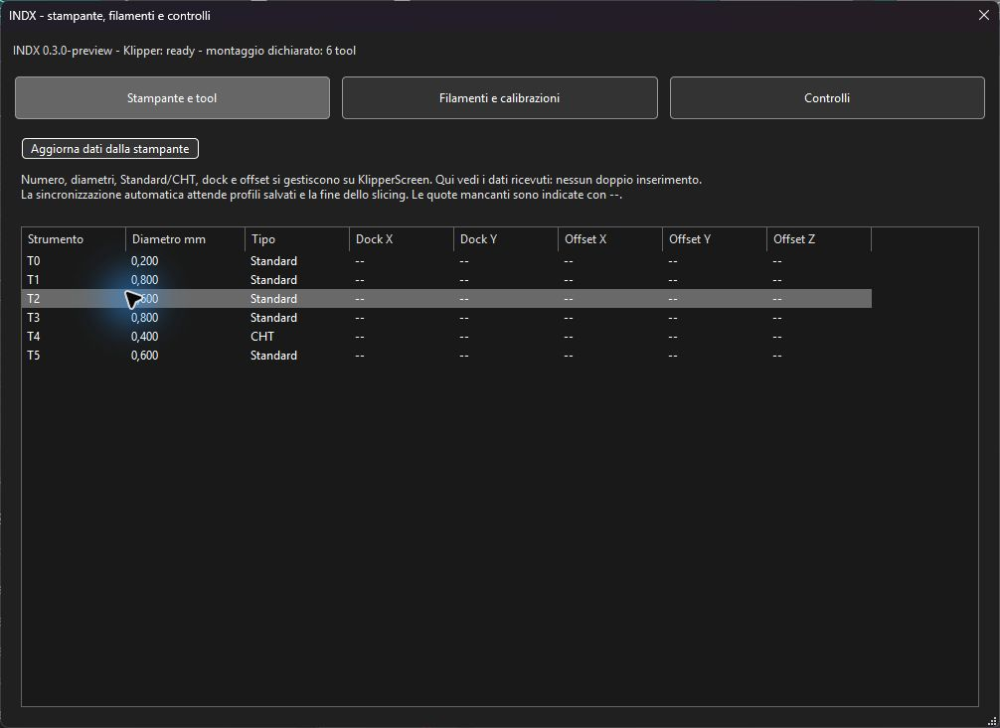
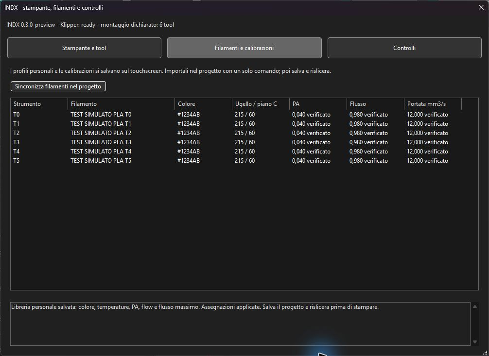
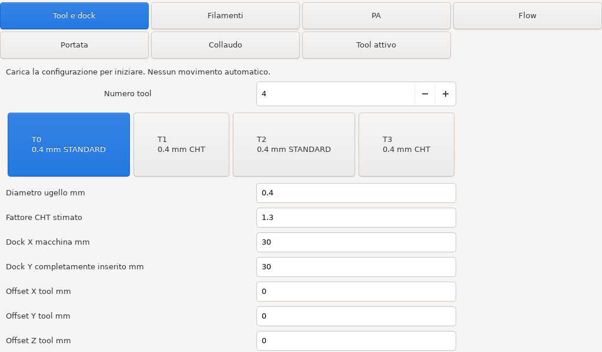
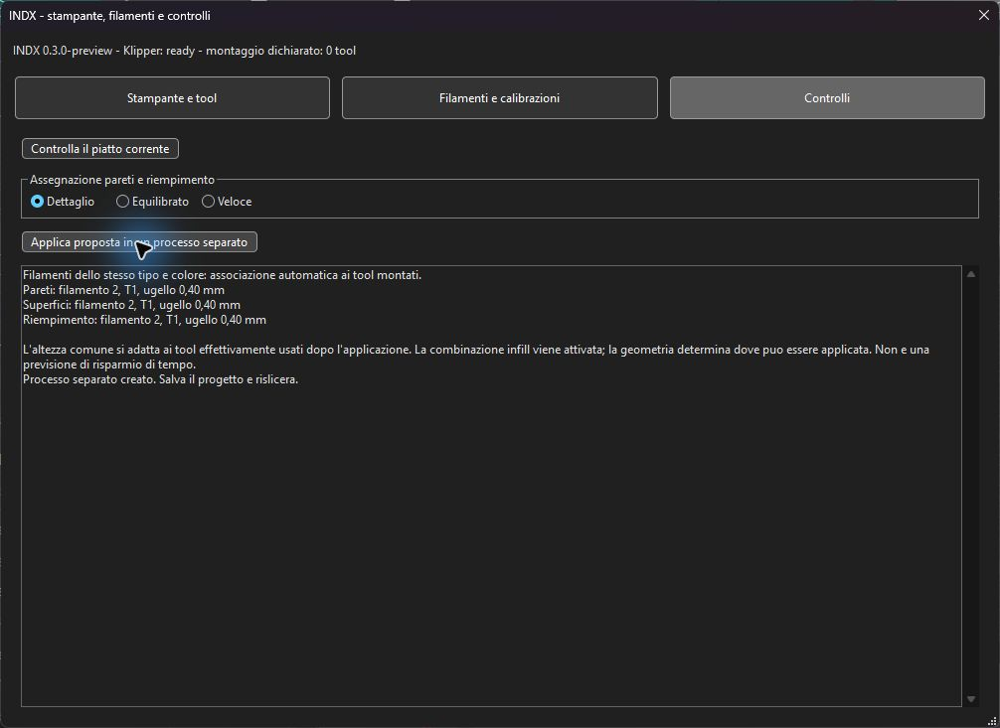
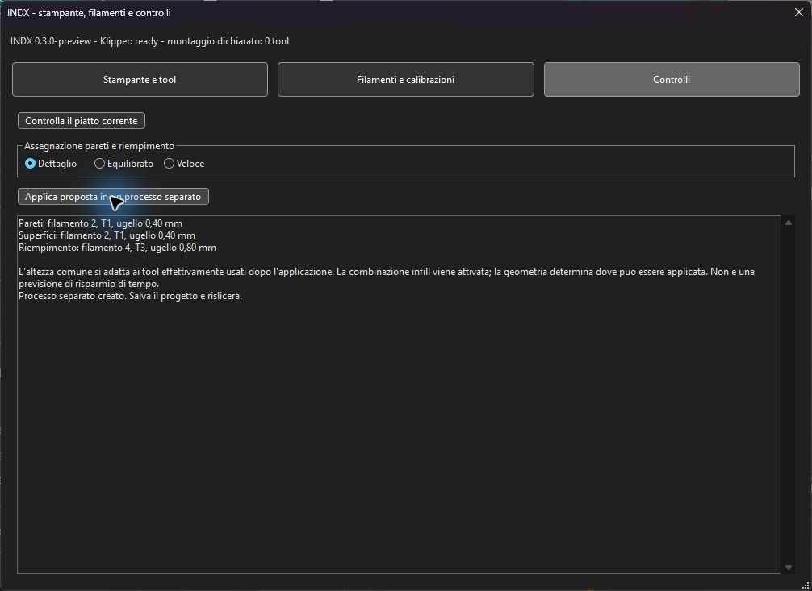
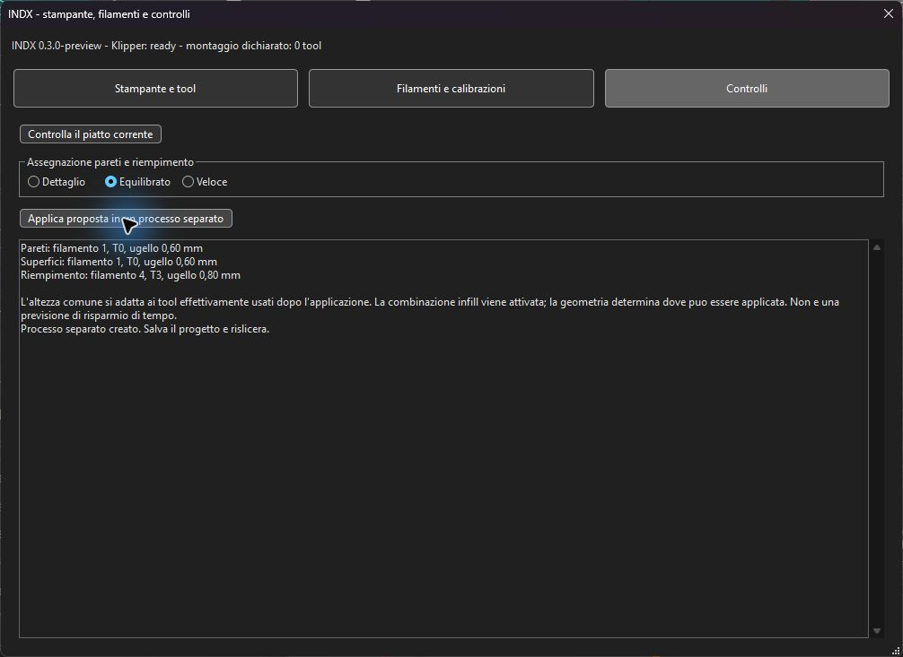
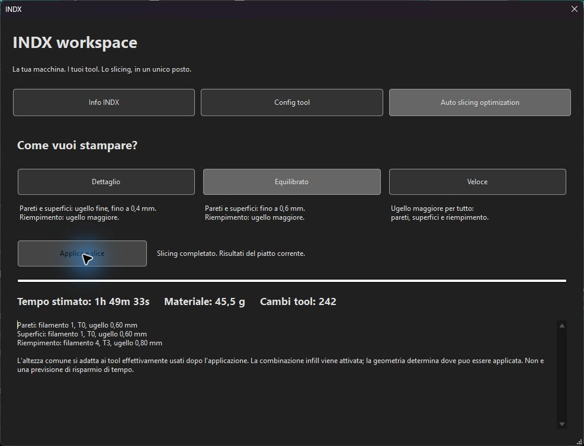
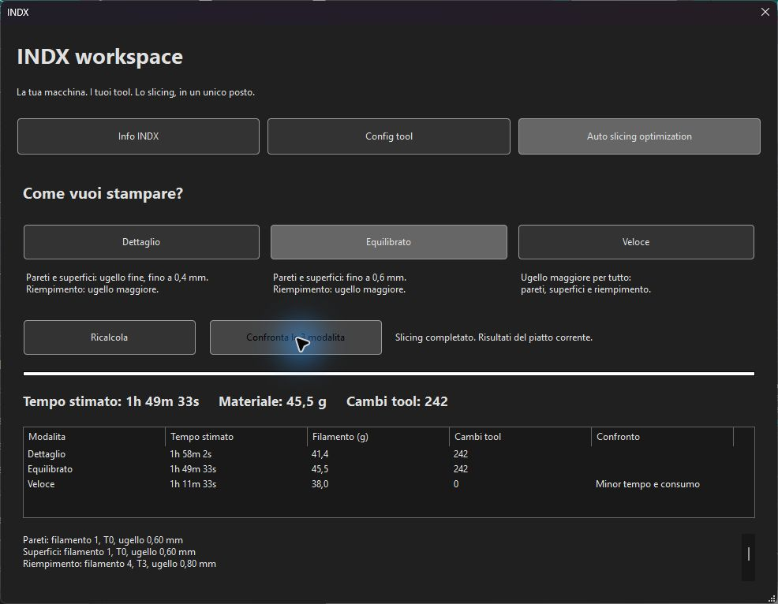

# Verifiche preview 0.3.0

Eseguite il 17 ottobre 2026. Nessun movimento, riscaldamento o flash eseguito sulla stampante reale per queste verifiche. La macchina resta nel profilo manutenzione.

| Prova | Risultato |
|---|---|
| Build Windows Release | Compilazione e collegamento della GUI riusciti |
| C++ IndxChecks | 195 asserzioni in 6 casi, ordine casuale |
| Regressioni GCodeWriter, CombinedInfill, UsedLayerTools | 467 asserzioni in 38 casi; pipeline invariata rispetto alla prova precedente |
| Python libreria/protocolli | Conteggi variabili, condizioni di calibrazione, storico e separazione tra catalogo e montaggio confermato |
| Editor macchina | 1/2/4/6/8/12/64 tool; controllo limiti e corsia, valori non validi, input con comandi respinto, macchina occupata, riscaldatori, revisione obsoleta e guasto rete |
| Dati e rollback | Backup, rollback di una transazione file interrotta, lettura delle sezioni Variables/variables, conservazione calibrazioni dopo aggiornamento software |
| Conferme fisiche | Richiedono revisione caricata, macro geometriche coerenti, testa/cella attive e i primi sei passaggi della checklist per il collaudo completo; nessuna conferma automatica |
| Offset persistenti | Modello Jinja provato nell'ambiente Kalico: applicazione una sola volta per revisione e nessuna sovrascrittura al riavvio dopo una calibrazione ufficiale |
| Orca GUI isolata | Tre pulsanti di selezione, nessun campo connessione INDX, lettura di sei tool con T4 CHT, cambio diretto delle pagine e report inline del piatto vuoto bloccato |
| GTK sullo SPI-XI | Costruzione/attivazione con 1/2/4/8/12 tool e visualizzazione delle sette pagine; aree scorrevoli espanse correttamente |
| Guida completa | 17 pagine renderizzate; controllo visivo di impaginazione e diagrammi |

Le schermate Orca usano dati TEST SIMULATO in una directory separata dai profili personali. Non rappresentano calibrazioni della stampante reale. Il wrapper clang-tidy richiede un'installazione Visual Studio registrata, assente nella toolchain portabile: quel controllo non e dichiarato superato. Il workflow GitHub controlla il pacchetto Python, non compila Orca e non sostituisce il collaudo fisico.

## Correzione delle proposte con filamenti identici

Build Windows Release riuscita. Suite IndxChecks: 213 asserzioni in 8 casi, ordine casuale. Copertura: mappatura vuota/tutta su T0 di quattro PLA dello stesso colore completata in 1/2/3/4; mappature personalizzate preservate; colori o tipi diversi non rimappati; meno filamenti dei tool non completati. Dettaglio con 0,6/0,4/0,6/0,8 sceglie il tool da 0,4; uno 0,2 associato prevale; tool fine senza filamento e assenza di ugelli fino a 0,4 respinti per Dettaglio.

La prova include anche una mappatura automatica intermedia 1/1/1/4: viene completata in 1/2/3/4 quando i quattro slot hanno tipo e colore identici. La lettura usa i diametri fisici delle schede tool e il colore del progetto, senza confonderli con la composizione delle varianti interne Orca.

Prova GUI sul progetto con quattro slot PLA dello stesso colore e ugelli 0,6/0,4/0,6/0,8: Dettaglio seleziona filamento 2, T1, 0,40 mm. Nel 3MF salvato la mappatura e 1/2/3/4 e le pareti esterne/interne e le superfici superiori sono assegnate al filamento 2. Nessuna stampa fisica eseguita.

Elaborazione del progetto completata anche nell'anteprima Orca dopo l'applicazione della proposta; nessun invio alla stampante.

## Dettaglio ed Equilibrato con riempimento multidiametro

Build Windows Release riuscita; suite IndxChecks aggiornata: 263 asserzioni in 10 casi, ordine casuale. Con T0=0,6, T1=0,4, T2=0,6 e T3=0,8: Dettaglio assegna pareti e superfici a T1 e infill a T3; Equilibrato assegna pareti e superfici a T0 e infill a T3. Uno 0,2 disponibile viene preferito per Dettaglio, conservando infill da 0,8. Questo sostituisce il comportamento della prima prova Dettaglio con infill fine descritta sopra.

Il controllo materiale riconosce il feeder INDX condiviso: T3 non viene scambiato per un estrusore fisico destro separato. Test su tool 0/1/3/12/31/63, capacita negate e indici invalidi; per le altre stampanti le capacita restano per estrusore. Nessuna modifica alle macro o ai gate di collaudo fisico.

Verifica GUI aggiornata: entrambe le combinazioni confermate nel riepilogo. Nel 3MF Dettaglio salvato: pareti interne/esterne e superfici superiori filamento 2, infill filamento 4, mappatura 1/2/3/4. Slicing completato con filamenti 2 e 4 e cambi testa nel riepilogo; nessun invio alla macchina.

## Veloce sul maggiore ugello

Build Windows Release riuscita. Suite IndxChecks: 275 asserzioni in 11 casi, ordine casuale. Veloce assegna wall/solid/infill al maggiore ugello; casi 0,6/0,8/1,0/1,2 con candidati in ordine non crescente. Dettaglio ed Equilibrato restano coperti dai test precedenti.

Verifica GUI: Veloce mostra T3 da 0,80 per pareti, superfici e riempimento. Nel 3MF salvato le sei funzioni proposte sono tutte sul filamento 4.

## Workspace con slicing integrato

Build Windows Release riuscita; 275 asserzioni in 11 casi IndxChecks passate. Prova GUI del flusso completo sulla stessa pagina: Equilibrato assegna 0,6/0,8, con stima 1h 49m 33s, 45,5 g e 242 cambi; Veloce assegna 0,8 per tutte le funzioni proposte, con stima 1h 11m 33s, 38,0 g e 0 cambi. Il G-code Veloce riporta 1h 11m 33s e 38,05 g, coerente con l'arrotondamento del pannello. Sono stime del progetto di prova, non misure di una stampa fisica.

Cambio modalita: metriche nascoste fino al nuovo slicing. Ricalcolo Veloce ripetuto: nessun nuovo processo duplicato. I comandi si riabilitano al termine. La home non contiene metriche o tabelle filamenti. Il montaggio e la sincronizzazione filamenti sono in Config tool. Nessun invio alla stampante.

Dettaglio verificato nello stesso pannello: pareti e superfici T1 da 0,4, infill T3 da 0,8; stima 1h 58m 2s, 41,4 g, 242 cambi.

## Cambio modalita con slicing automatico

Selezionando Dettaglio, Equilibrato o Veloce viene applicata la proposta e avviato automaticamente lo slicing nella stessa pagina. Il comando Ricalcola permette di ripetere la modalita corrente. I controlli vengono disabilitati subito durante il calcolo. Rimosso il pulsante duplicato Scegli come stampare dalla home.

Prova GUI: Veloce > Equilibrato completati premendo soltanto la modalita, senza Ricalcola. Metriche precedenti cancellate durante il calcolo e aggiornate alla fine; home senza pulsante duplicato. Build Release e 275 asserzioni IndxChecks passate.

## Matrice aggiuntiva di 60 slicing

967 asserzioni passate sui G-code esportati; regressioni 467/38 passate. [Report completo e risultati misurati](SIMULAZIONI_AUTO_INDX.md).

## Confronto affiancato delle modalita

Prova GUI Windows: Confronta le 3 modalita ha completato Dettaglio, Veloce, Equilibrato, tornando a Equilibrato selezionato all'inizio. Tabella simultanea: Dettaglio 1h 58m 2s / 41,4 g / 242 cambi; Equilibrato 1h 49m 33s / 45,5 g / 242 cambi; Veloce 1h 11m 33s / 38,0 g / 0 cambi. Evidenziato Minor tempo e consumo su Veloce. Sono stime del progetto di prova, non misure fisiche.

Verifica invalidazione: cambiando temporaneamente il layer da 0,20 a 0,18 mm, tutte le righe sono tornate Da calcolare e le metriche precedenti sono state nascoste. Il valore originale 0,20 mm e stato ripristinato. Nessuna stampa inviata. Suite IndxChecks: 275 asserzioni in 11 casi passate; pipeline FFF invariata rispetto alle 60 simulazioni documentate.

