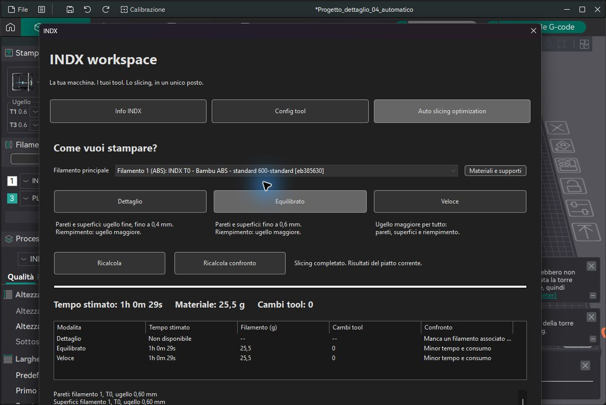

# Verifica software prima del montaggio INDX

Verifica del **17 ottobre 2026** sulla build Windows Release e sullo SPI-XI. Il sistema resta predisposto per il collaudo fisico: i test software non convalidano cablaggi, quote o adesione dei materiali.

## Esiti

| Area | Verifica e risultato |
|---|---|
| Regole, profili e sincronizzazione | 468 asserzioni /21 casi C++ superati; modifiche reali ai parametri protette |
| Slicing e G-code | 1481 asserzioni /42 casi superati, inclusi diametri e numero di tool variabili, limiti Z e infill combinato |
| Supporti | Quattro modelli con sporgenza slicerati con PLA/PETG, PETG/PLA, PLA/PVA, PETG/BVOH; interfaccia e corpo riconosciuti nel G-code, senza falso blocco INDX |
| Materiali | Regole per ruolo con fonti ufficiali datate; rigido/flessibile condizionale, nessuna estensione automatica a CF/GF o blend |
| Confronto nativo Orca | PLA: Dettaglio 1h38m12s, Equilibrato 1h36m54s, Veloce 1h8m23s. Stime software |
| Materiale con un solo ugello | ABS 0,6: Dettaglio non disponibile; Equilibrato e Veloce completati, 1h0m29s /25,5g/0 cambi. PLA escluso dal modello ABS |
| Riapertura 3MF | Eliminato il falso conflitto causato dal colore predefinito riscritto da Orca; nessun errore di sincronizzazione nella sessione verificata |
| Scambio reale colore | Orca → servizio stampante → libreria usata dal touch; variazione temporanea e ripristino originale verificati, stesso UUID, profili senza duplicati e parametri/calibrazioni invariati |
| Backend touch | Otto gruppi di test isolati superati: catalogo, libreria, ugelli, calibrazioni, commissioning, macchina, basi stock, conflitti e recupero della sincronizzazione |
| Aggiornamento e ripristino | Installazione, aggiornamento ripetuto, menu idempotenti e rollback provati in directory temporanee; dati recenti preservati |
| Profili di processo | 31 basi per diametro/layer verificate, 29 processi utente installati con nomi distinti; nessuna nuova serie di preset a codice |
| GTK sullo SPI-XI | Navigazione con 1/4/8/12 tool; elenchi filamento, annullamento senza scritture, UUID stabile; frame e font reali provati con 4/12 tool a 1024×600 e 1280×800 |
| Prestazioni touch | Catalogo da 2022 profili: mediana 34,55 ms, p95 145,92 ms; bozze preservate e schede riusate. Misura della sessione, non garanzia per ogni carico |
| Stampante | SSH, web e Moonraker raggiungibili; KlipperScreen, Klipper, Moonraker e servizio sync attivi; standby e cinematica di manutenzione `none` |
| Protezioni | Macro di controllo commissioning presente e capace di respingere operazioni; montaggio tool non ancora confermato. Nessun movimento, riscaldamento o flash eseguito in questa verifica |

Il confronto completo cancella le vecchie stime prima del ricalcolo, per evitare numeri del materiale precedente. Le modalita non disponibili conservano una motivazione, senza interrompere le altre. Il progetto finale torna al PLA in Dettaglio, con pareti/superfici 0,4 e infill 0,8; ABS resta caricato nello slot ma inutilizzato.

## Limite della verifica statica

Lo script clang-tidy richiede Visual Studio registrato; non riconosce la toolchain C++ portatile usata con successo per compilare Release. Il controllo non e dichiarato superato. Le build, le prove automatiche e i controlli applicativi sopra sono stati completati.

## Quando arriva il kit

1. Verificare il montaggio, i collegamenti del kit e il pinout sulla macchina reale; confrontare versioni e parametri firmware e definire il rollback prima di un eventuale flash.
2. Dichiarare su KlipperScreen i tool effettivi, diametri e tipi, senza usare quelli del progetto come conferma fisica.
3. Collaudare gradualmente finecorsa X, cella di carico Z e direzioni; misurare dock, quote sicure e offset. Le posizioni preparate/simulate non costituiscono quote validate.
4. Provare aggancio/parcheggio e pulizia ugello, poi homing, QGL, mesh e offset dei tool secondo le guide della conversione.
5. Eseguire prima una stampa piccola con un tool, poi cambi tool e multidiametro; verificare infine adesione e rimozione delle interfacce e calibrare i filamenti sul montaggio reale.

Il commissioning resta manuale e progressivo. Le calibrazioni PA, flow e portata vengono valutate sui provini: la cella di carico non rende automatiche queste misure.

[Guida completa](Guida_completa_INDX_Orca_KlipperScreen.pdf) · [Materiali, condizioni e fonti](COMPATIBILITA_MATERIALI.md) · [Regressioni materiali](PROVA_MATERIALI.md)

## Aggiornamento: mappatura principale e tool

[Rapporto mappatura](PROVA_MAPPATURA_TOOL.md): 65 casi e 1973 asserzioni superati, verifica nativa della scelta manuale e del confronto con il secondo filamento PLA da 0,4 mm. Le prove fisiche restano da eseguire dopo il montaggio.
